<p align="center">
  
</p>

<p align="center">
  <a href="#about">about</a> &nbsp;·&nbsp;
  <a href="#projects">projects</a> &nbsp;·&nbsp;
  <a href="#stack">stack</a> &nbsp;·&nbsp;
  <a href="#now">now</a> &nbsp;·&nbsp;
  <a href="#faq">faq</a> &nbsp;·&nbsp;
  <a href="#contact">contact</a>
</p>

<br/>

<a id="about"></a>

## about

BCA (Hons.) student at Galgotias University, Delhi. I build AI-powered products and Android/web apps.
Top 20 out of 100+ teams at a national hackathon. Yes, I'll bring it up again.

```kotlin
val gautam = Developer(
    focus    = listOf("AI/ML", "Kotlin", "Web"),
    building = listOf("RouteWise", "TuneGlass", "FilePeer"),
    learning = listOf("Advanced ML", "Cloud", "Distributed Systems"), // new ways to break prod
    sleep    = null,                                                   // NullPointerException
)
```

<br/>

<a id="projects"></a>

## projects

|  |  |  |
| :-- | :-- | :-- |
| **[RouteWise](https://routewisesafety.vercel.app/)** | AI that predicts accident risk, so your commute is slightly less "exciting". | AI/ML · Web |
| **[TuneGlass](https://github.com/Kmrr-Gautam)** | Music with zero ads. Revolutionary, I know. | Kotlin · Web + Android APK |
| **[FilePeer](https://thefilepeer.vercel.app)** | P2P file transfer. Stop emailing yourself `final_FINAL_v2.pdf`. | P2P · Web |

<br/>

<a id="stack"></a>

## stack

```text
languages   python · java · kotlin · c · javascript · sql   (sql counts, fight me)
ml          tensorflow · pytorch · keras · scikit-learn · opencv
mobile      kotlin · jetpack compose · android
tools       git · github · vscode · vercel · google antigravity
```

<br/>

<a id="now"></a>

## now

- building AI-powered apps and RouteWise
- learning advanced ML, cloud and distributed systems
- open to AI/ML, web dev and open-source collabs
- not available for: centering a div without googling it

<br/>

<a id="faq"></a>

## faq

<details>
<summary>is it production ready?</summary>
<br/>
It's on Vercel, so it's at least internet ready.
</details>

<details>
<summary>will you fix my bug?</summary>
<br/>
Send steps to reproduce and an error log. "It doesn't work" is a mood, not a bug report.
</details>

<details>
<summary>can I hire you?</summary>
<br/>
Yes. Email below. "Exposure" doesn't pay for GPUs, but good ideas and good people get my attention.
</details>

<br/>

<a id="contact"></a>

## contact

[gautamkrmd1234@gmail.com](mailto:gautamkrmd1234@gmail.com) &nbsp;·&nbsp;
[linkedin](https://linkedin.com/in/kmrrgautam) &nbsp;·&nbsp;
[instagram](https://instagram.com/kmrrgautam)

My inbox is open. My sleep schedule is not.

<br/>

<p align="center">
  <sub>star it if you liked it. or don't. i'll be fine. <code>exit 0</code></sub>
</p>
